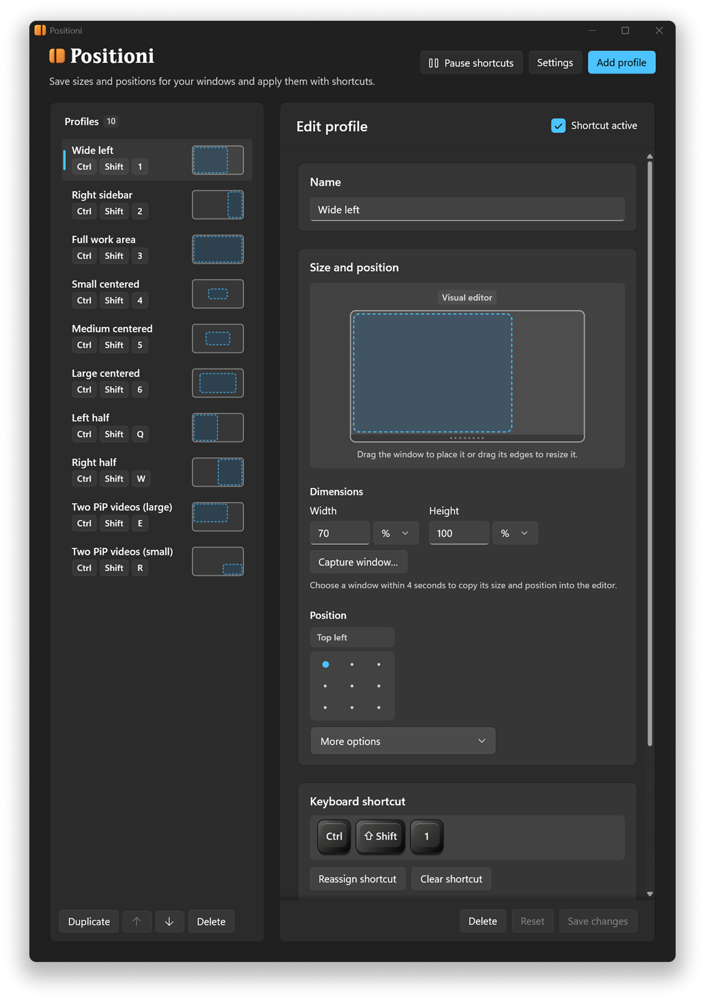

<p align="center">
  <picture>
    
  </picture>
</p>

<p align="center">Positioni lets you move and resize windows with custom keyboard shortcuts.</p>

<br>

## Description

Positioni is a Windows app that lets you save window sizes and positions as profiles and apply them to the active window with custom keyboard shortcuts.

<br>

## Screenshot

<p align="center">
  <picture>
    
  </picture>
</p>

<br>

## Download

**Latest version** `1.1.0` · [Changelog](https://github.com/neonglowstudio/positioni/releases/latest)

| Edition | Platform | How to start | Download link |
| --- | --- | --- | --- |
| Installer | Windows 11 (x64) | Run the installer. | [Download&nbsp;1.1.0&nbsp;installer](https://github.com/neonglowstudio/positioni/releases/download/1.1.0/positioni-1.1.0-win-x64-installer.exe) |
| Portable | Windows 11 (x64) | Extract the ZIP and open `Positioni.exe`. | [Download&nbsp;1.1.0&nbsp;portable](https://github.com/neonglowstudio/positioni/releases/download/1.1.0/positioni-1.1.0-win-x64-portable.zip) |

[Version history](https://github.com/neonglowstudio/positioni/releases)

<br>

## Features

- Save window sizes in pixels or as percentages of the monitor's work area.
- Draw, move, and resize a window in the visual editor, or capture its size and position from an open window.
- Use nine relative positions, exact coordinates, or resize a window in place.
- Assign global shortcuts to profiles, pause them together, or disable them individually.
- Choose from ten starter profiles or start with an empty list.
- Back up and restore your profiles, or import profiles from other window management tools.
- Start in the system tray when Windows starts.
- Light and dark modes.
- Adjustable interface size.
- Automatic update checks.

<br>

## Languages

English, Español, Português, Italiano, Français, and Deutsch.

<br>

## Additional information

### Import compatibility

Positioni can import profiles and shortcuts from the following tools:

- Positioni (`.json`)
- [Sizer](https://www.brianapps.net/sizer4/) (`.xml`)
- [WindowSizer](https://github.com/Mxlted/WindowSizer) (`.json`)
- [FancyZones](https://learn.microsoft.com/en-us/windows/powertoys/fancyzones) (`.json`)
- [DisplayFusion](https://www.displayfusion.com/HelpGuide/WindowPositionProfiles/) (`.json`, `.reg`)
- [AutoHotkey v2](https://github.com/AutoHotkey/AutoHotkey) (supported shortcuts in `.ahk` files)

### How updates work

When automatic update checks are enabled, both the installed and portable editions can notify you when a new version is available and provide a direct download link to the latest version of your edition.

### Code signing

The installer and portable executable are unsigned.

<br>

## Privacy

Profiles and settings are stored on your device. Positioni has no accounts, ads, or telemetry. Positioni checks the [releases in this GitHub repository](https://github.com/neonglowstudio/positioni/releases) for updates.

<br>

## Technology stack

| Component | Version | Source |
| --- | --- | --- |
| C# | 15.0 for the desktop app | [C# language repository](https://github.com/dotnet/csharplang) |
| .NET | Runtime 11.0.0, SDK 11.0.100 | [.NET runtime](https://github.com/dotnet/runtime), [.NET SDK](https://github.com/dotnet/sdk) |
| WinUI 3 and Windows App SDK | 2.6.5 (`Microsoft.WindowsAppSDK.WinUI`) | [WinUI](https://github.com/microsoft/microsoft-ui-xaml), [Windows App SDK](https://github.com/microsoft/WindowsAppSDK), [NuGet package](https://www.nuget.org/packages/Microsoft.WindowsAppSDK.WinUI/2.6.5) |
| Windows SDK Build Tools | 10.0.28000.2957 | [Microsoft's NuGet package](https://www.nuget.org/packages/Microsoft.Windows.SDK.BuildTools/10.0.28000.2957) |
| Inno Setup | 6.7.4 | [Inno Setup repository](https://github.com/jrsoftware/issrc) |

<br>

## Build from source

The build and packaging scripts use PowerShell. On Windows x64 with the .NET 11 SDK installed, run:

```powershell
.\scripts\build.ps1
```

To build the installer as well, run `.\scripts\package.ps1` with Inno Setup 6 available. Pass `-Iscc` if the compiler is outside your PATH.

<br>

## License and credits

Positioni's source code is licensed under the [GNU General Public License, version 3 only](LICENSE). The [trademark and branding policy](TRADEMARKS.md) covers the Positioni name, logo, and app icon.

- Designed and developed by [Neon Glow](https://neonglow.studio/).
- Positioni wordmark set in [Speltale](https://indieground.net/product/speltale-font/) by [Indieground Design](https://indieground.net/).
- Interface icons: [Segoe Fluent Icons](https://learn.microsoft.com/windows/apps/design/iconography/segoe-fluent-icons-font) by [Microsoft](https://www.microsoft.com/).
- GitHub icon: [Octicons](https://github.com/primer/octicons) by [Primer](https://primer.style/).
- Development assistance: [Codex](https://github.com/openai/codex) by [OpenAI](https://openai.com/).
